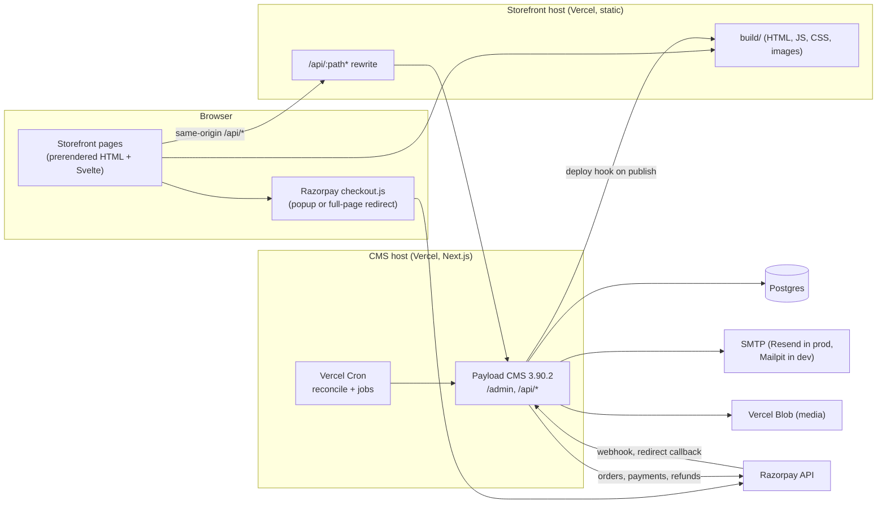
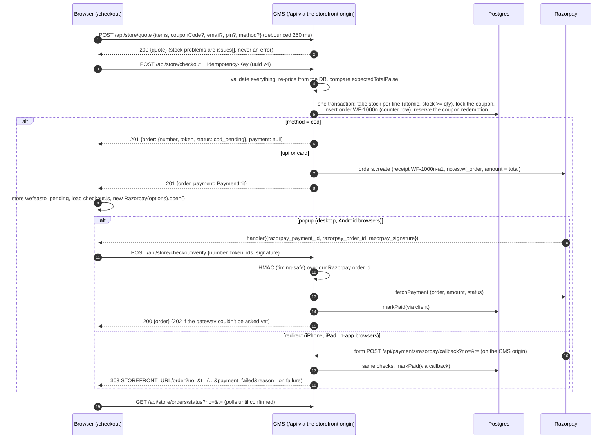
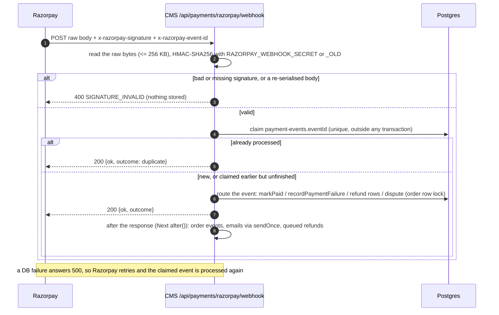

# Architecture

How the storefront, the CMS and Razorpay fit together. File paths are relative to the repo root. The CMS has
more detail in [cms/README.md](../cms/README.md); setup is in [README.md](../README.md) and hosting in
[DEPLOY.md](DEPLOY.md).

## 1. Components

| Part | Where | Notes |
|---|---|---|
| Storefront | `src/`, `static/`, `svelte.config.js`, `vite.config.js` | SvelteKit 2 + Svelte 5, adapter-static. Every route is prerendered (`src/routes/+layout.js` sets `prerender = true`). No server at runtime. |
| CMS | `cms/` | Payload 3.90.2, Next.js 16.3.6, React 19.2, `@payloadcms/db-postgres`. Custom endpoints live under `/api/store/*` and `/api/payments/*` (`cms/src/endpoints/index.ts`). GraphQL is off. |
| Shared rules | `cms/src/commerce/shared/*.js` (alias `$shared`) | Plain ESM JavaScript with no dependencies. The storefront and the CMS import the same files for money, quantities, validation, pricing, coupons, cart links, error copy and the order status machine. |
| Database | Postgres 16 | Dev and tests run in Docker (`docker-compose.yml`). The schema comes from `cms/src/migrations/` in production (cms/README.md "Migrations"). |
| Email | `@payloadcms/email-nodemailer` over SMTP | With `SMTP_HOST` empty, emails are written to the server log instead of sent. |
| Payments | `cms/src/payments/` | A `PaymentGateway` interface with two implementations: `RazorpayGateway` (a wrapper around razorpay@2.9.8) and `MockGateway`, an in-memory Razorpay. `PAYMENTS_MODE` picks one. |

Money is integer paise everywhere on the server and in `$shared`. The storefront keeps rupee `price` fields only
where the Phase 1 markup needs them.

## 2. Catalog: build-time snapshot, deploy hook, live overlay

Catalog content (products, recipes, published policy pages and the public store settings) reaches the storefront
at build time:

1. `src/lib/data/cms-snapshot.json` is the storefront's catalog and is committed. The adapters in `src/lib/data/`
   (`products.js`, `products-content.js`, `recipes-content.js`, `catalog-views.js`, `settings.js`) turn it into the
   shapes the Phase 1 pages expected. `vite.config.js` (`snapshotSplit()`) serves it as three virtual modules
   (`virtual:cms-snapshot/catalog`, `/recipe-bodies`, `/page-bodies`), so recipe and policy bodies ship only to the
   pages that show them.
2. `npm run build` runs `scripts/sync-cms.mjs` first (`prebuild`). With `CMS_SYNC=1` it fetches
   `GET {CMS_URL}/api/store/snapshot`, validates it (`src/lib/data/snapshot-schema.js`) and rewrites the JSON file
   when the content changed. A failed sync keeps the committed file and the build goes on, unless `CMS_REQUIRED=1`,
   which fails the build. Without `CMS_SYNC` the build uses the committed file.
3. The CMS calls the storefront's Vercel **deploy hook** (`VERCEL_DEPLOY_HOOK_URL`) when published catalog content or
   a public setting changes (`cms/src/hooks/deployHook.ts`). The call is debounced by 10 s, so ten saves in a row
   cause one rebuild. Edits to never-published drafts, pages that aren't on the storefront and server-only settings
   don't trigger it, and neither do the stock reservations checkout makes (they bypass collection hooks).
4. The seed (`cms/src/seed/`) goes the other way: it imports the committed snapshot into an empty CMS.
   `GET /api/store/snapshot` returns published content in exactly the snapshot's shape. An integration test checks
   the round trip.

**Live overlay.** Prices and stock can change between builds. Pages call `loadLive()` (`src/lib/live.js`) in
`onMount`, which fetches `GET /api/store/catalog` (`{settings, products:[{slug, name, pricePaise, inStock, lowStock,
maxPerOrder, codAllowed}]}`, cached `max-age=15, s-maxage=30`). The add buttons, prices, "Sold out" labels, the bag
and the free-delivery meter then use the live values. The prerendered HTML always shows the snapshot values, so
hydration matches. If the CMS can't be reached, the snapshot values stay. The overlay is advisory only: the server
prices every order again.

## 3. Same-origin `/api`

The browser only ever calls `/api/*` on the storefront's own origin, so the customer's `payload-token` cookie is a
first-party cookie and no CORS preflight is involved.

| Environment | What forwards `/api/*` to the CMS |
|---|---|
| `npm run dev` / `npm run preview` | Vite `server.proxy` / `preview.proxy` (`cmsProxy()` in `vite.config.js`) to `CMS_URL` (default `http://localhost:3000`). Only the Host header is rewritten. `Set-Cookie` loses its `Domain`, and over plain http also `Secure` (`devCookie()`). |
| Production | the `vercel.json` rewrite `/api/:path*` → `https://cms.wefeasto.com/api/:path*` (a placeholder domain; see DEPLOY.md) |
| e2e slots | the slot's `vite preview` proxies to the slot's CMS (`scripts/e2e/`) |

Razorpay talks to the CMS origin directly: the webhook and the redirect-mode `callback_url` use
`PAYLOAD_PUBLIC_SERVER_URL`. Email links for newsletter confirm and unsubscribe also point at the CMS origin, and
the CMS answers them with a 303 to the storefront.

## 4. Checkout

Code: `src/routes/checkout/+page.svelte` and `src/lib/checkout/` on the storefront. On the CMS,
`cms/src/endpoints/checkout/` handles HTTP and `cms/src/commerce/checkout/` holds the domain logic.

- **Idempotency.** The storefront keeps one `Idempotency-Key` per bag and form (`sessionStorage.wefeasto_idem`). The
  same key with the same payload replays the order (200). The same key with a different payload is 409
  `IDEMPOTENCY_MISMATCH`. Concurrent requests with one key create one order. The payload hash covers items, cleaned
  contact and address, method, coupon, expected total, consent and source.
- **Never trust the client's money.** Prices, names and images come from the database. `PRICE_CHANGED` (409)
  returns the new quote and the page asks for one more tap. Other refusals: `OUT_OF_STOCK`, `QTY_LIMIT`,
  `UNAVAILABLE`, `COUPON_INVALID`, `COD_UNAVAILABLE`, `PIN_UNSERVICEABLE`, `VALIDATION`, `ABOVE_MAX` and
  `RATE_LIMITED`. When Razorpay can't be reached the answer is 503 `PAYMENTS_UNAVAILABLE`: the order is kept with its
  stock held, and the page offers Try again or Pay on delivery.
- **Guest access.** Every order gets a random `tokenNonce`. The guest token is
  `base64url(HMAC_SHA256(PAYLOAD_SECRET, 'order:' + id + ':' + nonce))`, and only its sha256 is stored. `/order?no=&t=`,
  retry, verify and household updates all need it. An unknown order and a wrong token get the same 404 body.
  Rotating `PAYLOAD_SECRET` breaks every order link already sent.
- **Popup vs redirect.** The storefront always passes `callback_url` and never sets `redirect`. checkout.js itself
  switches to a full-page redirect on iOS and in-app browsers. Nothing on the redirect path relies on cookies.
- **After a failed or dismissed payment**, `POST /api/store/checkout/retry {number, token}` opens a new Razorpay order
  (receipt `-a2`, `-a3`, …, up to 10 attempts) and extends the reservation. Before it does, it asks Razorpay about
  the latest attempts, so a payment that already went through answers 409 `ALREADY_PAID`.
- **The order page** (`src/routes/order/+page.svelte`, a prerendered shell) polls the status endpoint every 2 s for
  30 s, then every 5 s. It shows confirming, confirmed, failed, waiting, review, cancelled or refunded. On the first
  confirmed view on the device that placed the order, it empties those lines from the bag, records "Your usual"
  (`wefeasto_last_order`) and fires `purchase` once. When an unpaid online order is polled and its newest attempt is
  older than 20 s, the status endpoint asks Razorpay after it answers (at most once per 15 s per order), so a late
  payment shows up even when the webhook is late.

## 5. Confirming payments: verify, callback, webhook, reconcile, markPaid

Four paths can report that money arrived. All of them end in **`markPaid`** (`cms/src/commerce/checkout/payments.ts`),
which runs under the order's row lock (`SELECT … FOR UPDATE`) and is idempotent:

| Path | Trigger | `paidVia` |
|---|---|---|
| verify | the Checkout handler in the browser (popup mode) | `client` |
| callback | Razorpay's form POST in redirect mode | `callback` |
| webhook | `payment.authorized`, `payment.captured`, `order.paid` | `webhook` |
| reconcile | the cron sweep, the status pull, retry's check | `reconcile` |

`markPaid` checks that the payment belongs to one of the order's Razorpay attempts and that the amount and currency
match. A mismatch is never marked paid: the order goes to `needs_review` with an ALERT log line. Then:

- already paid by this payment: only `authorized → captured` is recorded;
- already paid by a *different* payment: a full refund of the newcomer is queued (`WF-…-dup-…`);
- the order was cancelled (superseded) or refunded: the payment is refunded automatically (`-cxl-`);
- the order had expired and released its stock: the stock is taken again, and if it's gone, the order goes to
  `needs_review` with an automatic full refund (`-oos-`);
- otherwise the stock goes `reserved → committed`, the coupon redemption is consumed, `paidAt` and `paidVia` are set,
  and after commit `order.confirmed` is emitted once and the confirmation email is sent once.

Payments that are only authorised count as paid. The shop relies on Razorpay's automatic capture.

- Events for a Razorpay order the CMS doesn't know ("orphans") are logged and never refunded. They are attached
  only when `notes.wf_order` and the receipt prove they are ours (a lost `orders.create` response).
- `payment.failed` records the attempt and moves `pending_payment → payment_failed`. That status is never final: a
  late authorisation can still pay the order.
- Refund events update `refunds[]`. A full refund of an order that hasn't shipped puts its stock back.
  `payment.dispute.created` puts the order in `needs_review`, which holds fulfilment.
- **Reconcile** (`GET /api/payments/reconcile`, cron, `Authorization: Bearer $CRON_SECRET`, or a signed-in admin;
  `?order=WF-…` for a single order) sweeps: (A) unpaid online orders past `reservedUntil` or older than 10 min: pay
  them if Razorpay has a payment, otherwise expire them and release stock and coupon, but never when Razorpay
  couldn't be asked; (B) expired orders from the last 5 days, for late authorisations; (C) confirmed orders whose
  confirmation email never went out; (D) queued refunds, retried up to 12 times.

## 6. Stock: reservation, supersede, expiry

`products.stock` is a whole number of packs. It is operational state, so no form or REST call writes it as an
absolute number. Admins use "Adjust stock by (±N)" instead (`cms/src/lib/productStock.ts`, cms/README.md "Stock").

- **Reserve at order creation.** Checkout takes stock with one atomic conditional decrement per line
  (`UPDATE … SET stock = stock - qty WHERE id = … AND stock >= qty`, in ascending product id) inside the checkout
  transaction. The version row is updated too, so a later admin save can't write an old number back. Ten parallel
  checkouts for the last unit produce exactly one order (an integration test proves it).
- **States** (`orders.stockState`): online orders start `reserved` with `reservedUntil = now + reservationMinutes`
  (30 by default; the `store-settings` "Server only" tab). COD orders are `committed` at once. `markPaid` moves
  `reserved → committed`. Expiry and cancellation move `reserved → released` and add the stock back.
- **Expiry.** Reconcile section A expires unpaid online orders past `reservedUntil`, but only after asking Razorpay
  and finding no payment. A late payment on an expired order takes the stock again or is refunded (section 5).
- **Supersede.** A new checkout for the *same bag* cancels the customer's still-unpaid online orders from the last
  `max(reservationMinutes, 30)` minutes, in the same transaction, and releases their stock and coupon first. This is
  what makes "Pay on delivery instead" safe after a dismissed online payment. An order is only superseded when the
  checkout proves it belongs to the customer: the storefront sends `supersede: {number, token}` from
  `wefeasto_pending`, or the order was placed by the same signed-in customer. A shared phone number or email alone
  supersedes nothing. Money that later lands on a superseded order is refunded automatically.
- **Admin changes.** Cancelling an unshipped order releases its stock and coupon. Resolving `needs_review → paid`
  takes the stock again, and is refused with a 400 if the stock is gone.

## 7. Coupons and offers

- `coupons` (admin-only): `percent`, `fixed` or `free_delivery`, with optional `maxDiscountPaise`,
  `minSubtotalPaise`, a date window, `usageLimit`, `perCustomerLimit`, `firstOrderOnly` and `boundEmail`. The rules
  live in `$shared/coupons.js`. Percent discounts are rounded down to whole rupees. A discount never exceeds the
  subtotal and never takes the total below ₹1.
- There is no coupon box. Offers arrive by link: `/cart?offer=CODE` stores `wefeasto_offer` and shows a removable
  chip, and the server checks the code at quote and again at checkout.
- A quote never reveals whether an email or phone has ordered before. The first-order and per-customer checks run
  only at checkout, after `PRICE_CHANGED`.
- `coupon-redemptions` has one row per order: `reserved` at checkout, `consumed` when paid, `released` on expiry or
  cancellation. `usageLimit` counts `usedCount` plus live reservations, under a row lock on the coupon.
- **Welcome offer.** Confirming a newsletter subscription creates a personal code `HELLO-XXXX`: 10% off, capped at
  ₹75, first order only, bound to that email, valid 30 days. The terms come from `store-settings.welcomeOffer`.
  Addresses that already have an order get the welcome email without a code.

## 8. Emails and the message log

Every customer email goes through `sendOnce` (`cms/src/email/sendOnce.ts`). It first claims a unique `message-log.key`
and only then sends, so concurrent triggers send exactly one email. A failed send is marked `failed` and a later call
with the same key tries again.

| Key | Email | Sent by |
|---|---|---|
| `confirm:WF-…` | order confirmed (online), placed (COD), or "your payment went through" (late authorisation) | `markPaid` / COD checkout; reconcile retries it |
| `ship:WF-…` | order on its way | the admin setting fulfilment to `shipped` |
| `refund:<refund id>` | automatic refund notice (duplicate payment, out of stock, cancelled order) | queued refunds once Razorpay accepts them |
| `newsletter-confirm:<email>:<ms>` | confirm your subscription (double opt-in) | `POST /api/store/newsletter`, or checkout consent from a guest |
| `welcome:<email>` | welcome (with the offer code when eligible) | first confirmation |
| `refill:WF-…:1` | refill reminder | the `refillReminder` job |

Payload's own auth emails (verify account, reset password) link to the storefront (`/login?verify=`,
`/reset-password?token=`). Order emails carry "View your order" (`/order?no=&t=`) and "Buy these again"
(`/cart?add=slug:qty,…&src=email`). Marketing emails carry `List-Unsubscribe` and one-click `List-Unsubscribe-Post`
headers. Refunds made by hand in the Razorpay Dashboard send no email.

## 9. Order events and retention

`cms/src/commerce/events.ts` emits events after the transaction commits: `order.confirmed` (exactly once per paid
transition or COD order), `order.payment_failed`, `order.expired`, `order.cancelled`, `order.refunded`,
`order.shipped`, `order.delivered` and `order.household_updated`. Checkout code and the Orders `afterChange` hook
(for admin edits) emit them. The retention handlers (`cms/src/retention/register.ts`) subscribe:

- **Checkout consent** (`order.confirmed` with `consent.marketing`): when the order was placed by a signed-in,
  verified customer using their own email, the address is subscribed at once. For any other order (guest, COD or
  paid online) the address gets the double opt-in email first. An unsubscribe that came after the consent always
  wins, and so does an erased subscriber.
- **Newsletter** (`POST /api/store/newsletter`, honeypot field `website`): it always answers 200 for a well-formed
  email, so it can't be used to check membership. Confirm and unsubscribe are 303 redirects from the CMS back to the
  storefront home page (`?subscribed=…` / `?unsubscribed=…`).
- **Refill reminders** (`order.confirmed`, `order.household_updated`): a Payload job `refillReminder` is queued with
  `waitUntil` = about three quarters of the way through the estimated run-out, minus 2 days, at 10:00 IST. The
  estimate uses the product's `daysPerPack` and the household size from the "Breakfast for how many?" question on
  `/order` (2 if unanswered), clamped to 7–45 days. At run time it is skipped when the order is no longer confirmed,
  the address isn't a confirmed subscriber, or the customer has ordered again. One reminder per order.
- Jobs run only when `GET /api/payload-jobs/run?queue=default&limit=50` is called (cron, Bearer `CRON_SECRET`).
  There is no `autoRun`, and Payload's `schedule` isn't used, because its `payload-jobs-stats` global would be
  writable by any signed-in customer.

## 10. Auth model

| Who | How they authenticate | What they can do |
|---|---|---|
| Staff (`users`) | Payload admin login at `/admin` (cookie on the CMS origin) | `admin`: everything. `editor`: products, recipes, pages and media only. The first user is always an admin, and the last admin can't be deleted or demoted (`cms/src/auth/lastAdmin.ts`). |
| Customers (`customers`) | email + password through the storefront (`src/lib/session.js` → `/api/customers/login` etc.). The session is the HttpOnly `payload-token` cookie (SameSite=Lax, Secure in production, 30 days) on the storefront origin. | Read and update their own profile, `GET /api/store/orders/mine` (orders placed while signed in). They can't open `/admin`. The email must be verified before login. JWTs never appear in JSON responses (`removeTokenFromResponses`). |
| Guests | the order token in `/order?no=&t=` | View that one order (masked contact details, city and state only), retry its payment, answer the household question. Guest orders are never linked to an account afterwards. |
| Razorpay | HMAC signatures: payment signature (key secret) on verify and callback, webhook signature (webhook secret) on the webhook | `markPaid` and the other payment transitions, never anything else |
| Cron | `Authorization: Bearer $CRON_SECRET` (timing-safe compare; an empty secret never matches) | `GET /api/payments/reconcile`, `GET /api/payload-jobs/run`. A signed-in admin can call both too. |

- **Cookie trust.** `cors` and `csrf` in `cms/src/payload.config.ts` are both the `STOREFRONT_ORIGINS` list plus the
  CMS origin. A cookie is only honoured when the request's `Origin` is on that list (or, with no `Origin`, when
  the browser marks the request same-origin or same-site). On top of that,
  `cms/src/auth/crossSite.ts` refuses login, signup, forgot-password and reset-password from another site, which
  prevents login CSRF (signing a shopper's browser into an attacker's account). Server-to-server callers send
  `Authorization: JWT <token>`.
- Payload's internal collections `payload-preferences` and `payload-locked-documents`, and the draft versions of
  catalog documents, are staff-only (`cms/src/access/hardenInternals.ts`, `readVersions`). `payload-jobs` is closed
  to customers and guests.
- Orders, payment events, coupons, redemptions, subscribers and the message log are admin-only over REST. Admins can
  change only an order's status fields, and only along the allowed transitions (`$shared/order-status.js`).
- Mock-payment endpoints (`/api/payments/mock/*`) answer 404 unless `PAYMENTS_MODE=mock`. Mock mode is refused
  when `NODE_ENV=production` (unless `ALLOW_MOCK_PAYMENTS=1`, which is for e2e) and always when
  `APP_ENV`/`VERCEL_ENV` is `production` (`cms/src/env.ts`).

## 11. Rate limiting and client IP

`cms/src/lib/rateLimit.ts` is an in-memory sliding window keyed by client IP and route. Some auth routes are also
keyed by email. The limits are **per server instance**: they slow bursts from one client, but they aren't a global
quota. `RATE_LIMIT_DISABLED=1` turns them off, for tests only.

| Route | Limit per IP |
|---|---|
| quote / checkout / retry | 60 / 20 / 20 per min |
| verify / redirect callback | 30 per min (the callback still answers 303) |
| order status | 240 per min, and 60 per min per IP and order |
| orders/mine | 30 per min |
| newsletter sign-up / confirm and unsubscribe links / household | 5 / 60 / 20 per min |
| snapshot / CSP reports | 30 / 30 per min |
| customer signup / login / forgot / reset / verify / resend | 5 per 10 min / 10 per min / 5 per 10 min + 3 per hour per email / 10 per 10 min / 10 per 10 min / 5 per min + 1 per 10 min per email |
| webhook, reconcile, jobs | none (signature or secret required) |

The client IP comes from `x-real-ip`, else the first `x-forwarded-for` hop (`getClientIp` in `cms/src/lib/http.ts`).
Checkout allows 20 per minute rather than 10 because Indian mobile carriers put many customers behind one CGNAT
address. How the IP arrives through the storefront's rewrite matters; see SECURITY.md.

## 12. The shared commerce module (`$shared`)

`cms/src/commerce/shared/` is imported by the CMS through relative paths and by the storefront through the
`$shared` alias (`svelte.config.js`). One copy of each rule means the price in the bag is the price the server
charges.

| File | What |
|---|---|
| `settings.js` | the public and server-only settings keys, defaults and normalisation (`PUBLIC_SETTINGS_DEFAULTS`) |
| `money.js`, `qty.js` | `formatPaise`, `rupeesToPaise`; strict `parseQty` for requests, lenient `clampQty` for storage and links |
| `validate.js` | Indian mobile numbers, PIN codes, emails, the checkout form, the 36 states and union territories |
| `pricing.js` | `quote()` (lines, subtotal, discount, delivery, COD fee, total, free-delivery progress, issues, COD availability) and `topUpSuggestion()` |
| `coupons.js` | `evaluateCoupon()`, `buildWelcomeCoupon()` |
| `cart-links.js` | `parseAddParam` / `buildAddParam` for `/cart?add=slug:qty,…` |
| `errors.js` | error codes and customer-facing copy, `paymentReasonCopy()` |
| `order-status.js` | status constants, `nextStatus()` (forward-only), `canRetryPayment()`, `isConfirmed()` |

Free delivery is judged on the subtotal *before* the discount, so a coupon never takes it away. The delivery fee,
threshold, COD limits and welcome-offer terms are data in `store-settings`, not code.

## 13. Storefront additions in Phase 2

All of these are client-side additions to the prerendered Phase 1 pages. Content stays visible without JS, motion
goes through `window.gsap` and is gated on `$lib/fx.js` (`?nofx=1`, `prefers-reduced-motion`), and new CSS lives in
marked "Phase 2" sections of `static/css/wefeasto.css` plus `static/css/wf-checkout.css` and
`static/css/wf-account.css`. `tools/regression-allowlist.json` lists every intended difference from the Phase 1
build, with a reason for each.

| Addition | Where | Notes |
|---|---|---|
| PeepWalk crowd | `src/lib/components/PeepWalk.svelte`, `static/images/peeps/characters.png` (+ `CREDITS.txt`) | A 1:1 port of bublr's `PeepWalk.js`, at the owner's request: all 105 Open Peeps at native size, a 350px strip, and the same GSAP walk and draw order. Frames are pixel-identical to bublr's for the same random sequence. The additions don't change what's drawn: cleanup on destroy, lazy loading, pausing off-screen and in hidden tabs, a still frame under reduced motion or `?nofx=1`, and a pause button (WCAG 2.2.2). **Don't change its visuals, crowd size, timing, sprite, frame rate or size.** |
| Crowd strip | `src/lib/components/PeepStrip.svelte` | In the layout, above the footer. Not shown on `/checkout`, `/login`, `/order` or `/reset-password`. `/order` shows its own crowd while confirming and once confirmed. |
| Spinner, Squiggle | `Spinner.svelte`, `Squiggle.svelte` | bublr's spinner and hand-drawn underline. The Squiggle draws once on the first confirmed view of an order. |
| Mini-bag toast | `CartToast.svelte` (lazy-loaded by `+layout.svelte`) | Non-modal, shown after each add. It holds the meter, a top-up suggestion and Checkout / View bag buttons. Not shown on `/cart`, `/checkout` or `/order`. |
| Free-delivery meter and top-up | `FreeDeliveryMeter.svelte`, `TopUp.svelte` | "₹X away from free delivery" and a one-tap add, in the cart, the checkout summary and the toast. Built on `$shared` `quote` and `topUpSuggestion`. |
| Your usual | `YourUsual.svelte` | Built from `wefeasto_last_order`. Appears in the empty bag, on `/shop` and on home, and adds the missing units in one tap. |
| Reorder links | `$lib/cart.js`, `$shared/cart-links.js` | `/cart?add=slug:qty,…&src=…` (email "Buy these again", refill reminders) and `/cart?offer=CODE`, both read in `onMount` only. |
| Mobile nav | `MobileNav.svelte`, hamburger `#wf-menu-btn` in `Nav.svelte` | At ≤991px. A dialog with a focus trap that Esc closes; z-index 1050. |
| Branded 404 | `NotFound.svelte`, `src/routes/+error.svelte`, `src/routes/404/+page.svelte` | Prerendered to `build/404.html`, which Vercel serves with a 404 status. `staticWith404()` in `svelte.config.js` makes its asset paths root-absolute and fails the build if the file is missing. |
| Product facts, perks line | `ProductFacts.svelte`; PDP `src/routes/products/[slug]/+page.svelte` | A `
` that lists only the facts that exist, and "Buying here: free delivery over ₹499 · COD available · …". |
| Recipe rail add | `src/routes/recipes/[slug]/+page.svelte` | "Add Muesli · ₹250" for the recipe's first product. |
| Announcement bar | `AnnouncementBar.svelte` | Off by default. Turned on in `store-settings`, and it needs a rebuild. |
| Checkout and order | `src/routes/checkout`, `src/routes/order`, `src/lib/checkout/`, `PayButton`, `CheckoutNote`, `PendingOrderBanner`, `OrderView` | UPI / Card / Cash on Delivery pills. The form never collects card or UPI data. A "waiting for payment" banner on `/cart` and `/checkout` recovers orders that were never paid. |
| PIN autofill | `src/lib/checkout/pin.js`, `static/pin/*.json` | City and state from the PIN, using GeoNames data (CC BY 4.0, credited in `static/pin/CREDITS.txt`). It never overwrites what the customer typed. |
| Accounts | `src/routes/login`, `account`, `reset-password`, `src/lib/session.js` | Sign up (email verification), log in, forgot and reset password, order history. "Continue with Google" is hidden. |
| Newsletter | the home page's "Stay Crunchy" form | Posts to `/api/store/newsletter`, with a honeypot and double opt-in copy. |
| Policy pages, legal line | `src/routes/[policy=policy]`, `Footer.svelte`, `src/routes/+layout.server.js` | Only published pages are built and linked in the footer. The footer shows the FSSAI line only when it's set. |
| WhatsApp help | `src/lib/support.js` | Uses `supportWhatsappE164` from the settings. |
| Funnel events | `src/lib/track.js` | Pushes to `window.dataLayer` and fires `wf:track` events. No analytics vendor is wired in. |

Browser storage (every access is wrapped in try/catch, and the site still works with storage blocked; nothing
secret is stored, since the session is the HttpOnly cookie):

- `localStorage`: `wefeasto_cart`, `wefeasto_pending`, `wefeasto_placed_<no>`, `wefeasto_last_order`,
  `wefeasto_seen_<no>`, `wefeasto_checkout` (only with "Save my details"), `wefeasto_offer`, `wefeasto_usual_hidden`,
  `wefeasto_announce_dismissed`, `wefeasto_colormix`, `wefeasto_peeps_paused`, `wefeasto_signed_in` (a hint that
  this browser has signed in, so pages only call `/api/customers/me` when it may pay off).
- `sessionStorage`: `wefeasto_idem`, `wefeasto_placing`, `wefeasto_kept`, `wefeasto_pending_form`, `wefeasto_src`,
  `wefeasto_topup_dismissed`, `wefeasto_verify_token` / `wefeasto_reset_token` (a link token kept for the tab so a
  failed attempt can be retried).
